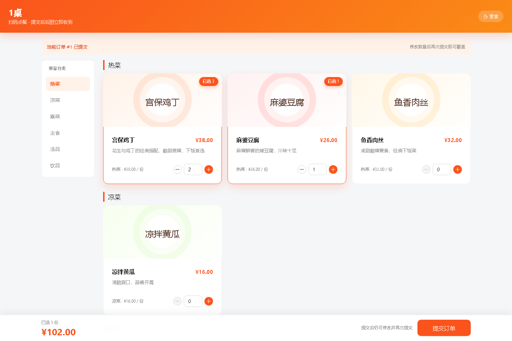
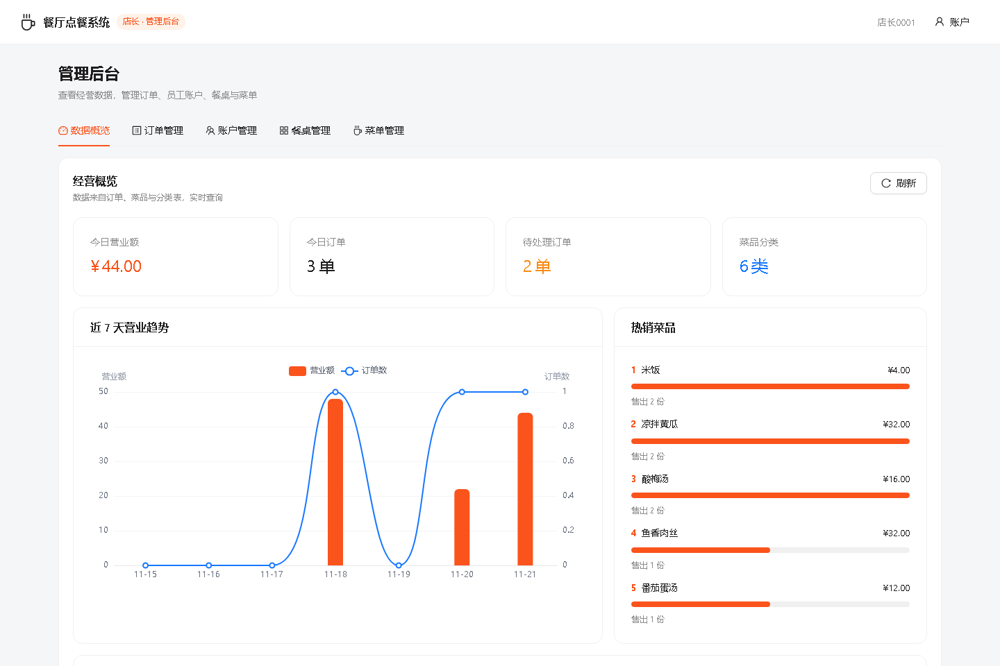

# 餐厅点餐系统 / Restaurant Ordering System

> 2026 秋季《Web数据库技术》课程大作业 · 最终成品
>
> 前后端分离 · 扫码点餐 · 店长/厨师/收银员三端协同 · 6 张业务表 · 28 个 REST 接口 · 35 条接口测试

餐厅点餐系统面向小型餐厅堂食场景，打通“店长配置 → 顾客扫码点餐 → 后厨制作 → 收银结账 → 数据统计”的完整业务闭环。顾客无需注册和登录，扫描餐桌二维码即可点餐；店长、厨师、收银员使用独立工作台。




## 1. 功能概览

系统共 4 个业务角色，其中只有店长、厨师、收银员拥有登录账户，顾客是匿名扫码用户。

| 角色 | 入口 | 核心功能 |
| --- | --- | --- |
| 店长 | `/admin` | 数据概览、订单检索、账户管理、餐桌与二维码、菜单分类、菜品与图片管理 |
| 厨师 | `/kitchen` | 查看所有餐桌订单，逐菜标记做好/撤销 |
| 收银员 | `/cashier` | 查看所有餐桌订单，完成结账（未做的菜也视为做好） |
| 顾客 | `/order/{二维码编码}` | 免登录查看菜单、增减数量、提交/覆盖订单、多端同步 |

- **认证**：JWT 长期登录；密码使用 PHP `password_hash()`（bcrypt）哈希存储。
- **账户**：店长创建/删除厨师、收银员账户；所有登录角色可修改密码。
- **餐桌**：自动命名、改名去重、固定编码二维码（改名不失效）。
- **菜单**：菜品分类增删改；菜品名称、价格、描述、图片、分类；分类下有在售菜品时不能删除。
- **图片**：上传到后端 `backend/storage/uploads`，文件名由后端随机生成，不保留用户原始文件名；删除菜品同步删除图片。
- **订单**：同一桌最多一个未结账订单；再次提交覆盖旧订单；数量未变的菜品保留已做状态。
- **状态**：`pending`（未结账，页面可显示制作中/已上齐）→ `paid`（已结账）。
- **多端**：顾客页每 5 秒轮询同步；后厨/收银每 5 秒刷新。
- **统计**：今日营业额/订单、近 7 天趋势、热销菜品、分类/菜品/餐桌数量。
- **安全**：JWT、后端角色守卫、PDO 预处理、上传 MIME/大小/路径校验、图片文件名随机化。

## 2. 技术栈

- 前端：Vite 6 + React 18 + TypeScript 5.7 + Ant Design 5 + React Router 6 + Axios + ECharts 6
- 后端：PHP 8.5（原生，无框架依赖；自行实现路由、JWT、PDO 数据访问）
- 数据库：MySQL 8.0+（utf8mb4 / InnoDB）
- 密码：`password_hash()` / `password_verify()`（bcrypt）
- 部署：PHP 内置 HTTP 服务器 + `start.bat` / `start.sh`，无需 Apache / Nginx

## 3. 目录结构

```text
restaurant-ordering/
├── backend/
│   ├── api.php                    # API 入口与 28 条路由
│   ├── router.php                 # PHP 内置服务器路由（/api + SPA 回退）
│   ├── bin/migrate.php            # 初始化/重置数据库
│   ├── database/
│   │   ├── schema.sql             # 6 张业务表
│   │   ├── seed.sql               # 种子数据
│   │   └── init.sql               # 建库 + 建表 + 种子数据
│   ├── src/
│   │   ├── Controllers/           # Auth/User/Table/Menu/Order/Admin/Upload
│   │   ├── Auth.php               # JWT 与用户上下文
│   │   ├── Database.php
│   │   └── Support/Installer.php  # 自动建库、种子数据、演示图片
│   ├── storage/uploads/           # 上传图片（后端随机文件名）
│   └── .env.example
├── frontend/
│   ├── src/
│   │   ├── pages/                 # 登录/店长/后厨/收银/顾客点餐
│   │   ├── api/client.ts
│   │   └── auth/AuthContext.tsx
│   └── dist/                      # 前端构建输出（需构建）
├── tests/api-test.mjs             # 35 条接口测试
├── docs/                          # 开发文档、用户手册、过程材料、PPT
├── start.bat / start.sh
├── README.md
└── .gitignore
```

## 4. 快速开始

### 4.1 环境要求

- PHP 8.2+（启用 `pdo_mysql`、`mbstring`、`fileinfo`）
- Node.js 20+ 与 pnpm
- MySQL 8.0+（可远程或本地）

### 4.2 配置数据库

复制模板并按实际环境修改：

```bash
cp backend/.env.example backend/.env
# Windows: copy backend\.env.example backend\.env
```

```dotenv
JWT_SECRET=please-change-this-secret
JWT_TTL=315360000

DB_HOST=172.23.89.219
DB_PORT=3306
DB_DATABASE=restaurant_ordering
DB_USERNAME=root
DB_PASSWORD=root
```

`backend/.env` 已加入 `.gitignore`，不要提交真实密码。若使用远程数据库，填写远程地址并放行 3306 端口。

### 4.3 初始化数据库

首次启动会自动建库、建表和写入种子数据；也可手动执行：

```bash
# 可重复执行，不会清空已有数据
php backend/bin/migrate.php

# 重置数据库（会删除并重建，慎用）
php backend/bin/migrate.php --fresh

# 或使用纯 SQL（建库 + 建表 + 种子数据；Windows 建议指定 utf8mb4）
mysql --default-character-set=utf8mb4 -u root -p < backend/database/init.sql
```

种子数据包含：3 个员工账户、6 张餐桌、6 个菜品分类、8 道菜、5 笔示例订单。

### 4.4 构建前端

```bash
cd frontend
pnpm install
pnpm build
```

`frontend/dist/` 是构建产物，已被 `.gitignore` 忽略；从仓库克隆后必须先构建，启动脚本才能找到静态文件。

### 4.5 启动

Windows：

```bat
start.bat
```

Linux：

```bash
chmod +x start.sh
./start.sh
```

浏览器访问 <http://localhost:8000>。

> `0.0.0.0:8000` 是监听地址，不是访问地址。本机用 `localhost`；手机用电脑局域网 IP（如 `http://192.168.1.10:8000`），并放行防火墙 8000 端口。

### 4.6 演示账号

| 角色 | 用户名 | 密码 | 入口 |
| --- | --- | --- | --- |
| 店长 | `admin` | `123456` | `http://localhost:8000/admin` |
| 厨师 | `chef01` | `123456` | `http://localhost:8000/kitchen` |
| 收银员 | `cashier01` | `123456` | `http://localhost:8000/cashier` |

顾客无需登录：店长在“餐桌管理”中展示二维码，顾客扫码进入 `/order/{publicCode}` 即可点餐。

## 5. 数据库设计

共 6 张业务表：

| 表 | 作用 | 关键约束 |
| --- | --- | --- |
| `users` | 员工账户（店长/厨师/收银员） | `username` 唯一；密码 bcrypt 哈希；角色枚举 |
| `dining_tables` | 餐桌与二维码固定编码 | `public_code` 唯一；`name` 唯一 |
| `menu_categories` | 菜品分类 | `name` 唯一；`is_active` 软删除 |
| `menu_items` | 菜品、价格、描述、图片 | `category_id` 外键；`is_active` 软删除；价格校验 |
| `orders` | 订单主表 | `pending_table_id` 唯一，保证每桌最多一个未结账订单 |
| `order_items` | 订单明细 | `(order_id, menu_item_id)` 唯一；`is_done` |

金额不冗余存储，由 `order_items.quantity × menu_items.price` 实时汇总；订单、明细、分类通过外键保证引用完整性。完整 ER 图、字段、索引与外键见开发文档第 4 章。

## 6. API 一览

Base URL：开发环境 `http://localhost:8000/api`，生产环境 `/api`。除公开接口外，请求头需带 `Authorization: Bearer <token>`。

| 方法 | 路径 | 权限 | 说明 |
| --- | --- | --- | --- |
| POST | `/auth/login` | 公开 | 员工登录，返回 JWT |
| GET | `/auth/me` | 登录用户 | 当前用户信息 |
| POST | `/auth/password` | 登录用户 | 修改密码 |
| GET | `/users` | 店长 | 账户列表 |
| POST | `/users` | 店长 | 创建厨师/收银员 |
| DELETE | `/users/{id}` | 店长 | 删除账户 |
| GET | `/tables` | 店长 | 餐桌列表 |
| POST | `/tables` | 店长 | 新增餐桌（自动命名） |
| PATCH | `/tables/{id}` | 店长 | 修改餐桌名称 |
| DELETE | `/tables/{id}` | 店长 | 删除餐桌 |
| GET | `/tables/overview` | 厨师/收银员 | 餐桌与最近订单 |
| GET | `/menu` | 公开 | 在售菜单 |
| GET | `/menu/categories` | 公开 | 分类列表 |
| POST | `/menu/categories` | 店长 | 新增分类 |
| PUT | `/menu/categories/{id}` | 店长 | 分类重命名 |
| DELETE | `/menu/categories/{id}` | 店长 | 删除分类（有在售菜品时拒绝） |
| POST | `/menu` | 店长 | 新增菜品 |
| PUT | `/menu/{id}` | 店长 | 修改菜品 |
| DELETE | `/menu/{id}` | 店长 | 删除菜品并删除图片 |
| POST | `/uploads` | 店长 | 上传图片（后端生成唯一文件名） |
| GET | `/uploads/{filename}` | 公开 | 读取图片 |
| GET | `/orders/table/{code}` | 公开 | 扫码读取当前订单 |
| PUT | `/orders/table/{code}` | 公开 | 提交/覆盖订单 |
| PATCH | `/order-items/{id}` | 厨师 | 标记菜品做好/撤销 |
| POST | `/orders/{id}/pay` | 收银员 | 结账 |
| GET | `/admin/orders` | 店长 | 订单搜索/筛选/分页 |
| GET | `/admin/orders/{id}` | 店长 | 订单详情 |
| GET | `/admin/stats` | 店长 | 经营统计 |

完整请求/响应示例与错误码见 [开发文档](docs/开发文档-餐厅点餐系统.docx) 第 5 章。

## 7. 测试

测试前建议重置为干净种子数据：

```bash
php backend/bin/migrate.php --fresh
node tests/api-test.mjs
```

本次执行结果：**35 条用例全部通过，0 失败**。覆盖：

- 正常：登录、创建员工/餐桌/分类/菜品、上传、点餐、覆盖、标记、结账、统计
- 异常：错误密码、重复用户名、重复分类、空订单、非法分类、重复结账、无效二维码
- 权限：未登录、厨师越权、非店长访问管理接口
- 安全：SQL 注入登录、上传非图片、文件名随机化、路径穿越

测试明细与用例表见 [开发文档](docs/开发文档-餐厅点餐系统.docx) 第 6 章。

## 8. 安全与文件上传

- 密码使用 `password_hash()` / `password_verify()`，不在数据库保存明文或快速 SHA-256 摘要。
- 所有数据库访问使用 PDO 预处理。
- 后端按路由声明角色，越权请求返回 403。
- 上传只接受 JPG/PNG/GIF/WEBP，校验 `getimagesize`、MIME、5MB 大小。
- 上传文件名完全由后端 `random_bytes()` 生成，不保留用户原始文件名或扩展名。
- 图片读取做文件名白名单和 `realpath` 根目录校验，防止路径穿越；删除菜品时同步删除图片。
- 前端不使用 `dangerouslySetInnerHTML`，菜品图片地址只接受 `/api/uploads/...`。

## 9. 文档与交付物

| 交付物 | 路径 |
| --- | --- |
| 开发文档（需求/设计/ER/API/测试/部署） | [docs/开发文档-餐厅点餐系统.docx](docs/开发文档-餐厅点餐系统.docx) |
| 用户使用手册 | [docs/用户使用手册-餐厅点餐系统.docx](docs/用户使用手册-餐厅点餐系统.docx) |
| 项目选题提案表 | [docs/01-项目选题提案表.docx](docs/01-项目选题提案表.docx) |
| 分工与 Git 贡献表 | [docs/02-分工与Git贡献表.docx](docs/02-分工与Git贡献表.docx) |
| 组内互评表 | [docs/03-组内互评表.docx](docs/03-组内互评表.docx) |
| 挑战功能说明表 | [docs/04-挑战功能说明表.docx](docs/04-挑战功能说明表.docx) |
| 最终汇报 PPT（HTML 放映 / PPTX） | [docs/ppt/餐厅点餐系统-最终汇报.html](docs/ppt/餐厅点餐系统-最终汇报.html) · [.pptx](docs/ppt/餐厅点餐系统-最终汇报.pptx) |
| 项目开发文档（需求源文件） | [docs/项目开发文档.md](docs/项目开发文档.md) |

## 10. 常见问题

- **8000 端口被占用**：关闭占用程序，或同时修改启动脚本和前端 API 地址后重新构建。
- **PHP 报 `could not find driver`**：在 `php.ini` 中启用 `pdo_mysql` 并设置正确的 `extension_dir`。
- **页面没有数据 / 数据库被删**：执行 `php backend/bin/migrate.php --fresh` 重建。
- **手机扫码打不开**：用电脑局域网 IP 访问系统后再展示二维码，确认同一网络且防火墙放行 8000。
- **上传图片失败**：仅支持 JPG/PNG/GIF/WEBP，且不超过 5MB。

## 11. 小组

| 姓名 | 角色 | 主要工作 |
| --- | --- | --- |
| 马见川 | 组长 / 后端与架构 | 需求、数据库、接口、JWT、订单状态、联调、文档 |
| 董睿 | 前端基础 / 店长端 | 前端工程、登录、店长后台、账户/餐桌/菜单 |
| 应一帆 | 顾客端 / 交互 | 扫码点餐、购物车、多端同步、二维码 |
| 陈嘉尚 | 后厨 / 收银 / 测试 | 看板、收银、测试、种子数据、部署材料 |

2026 年 11 月
